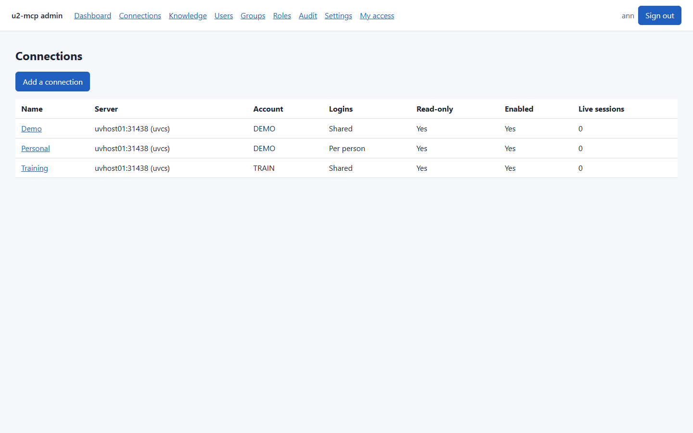
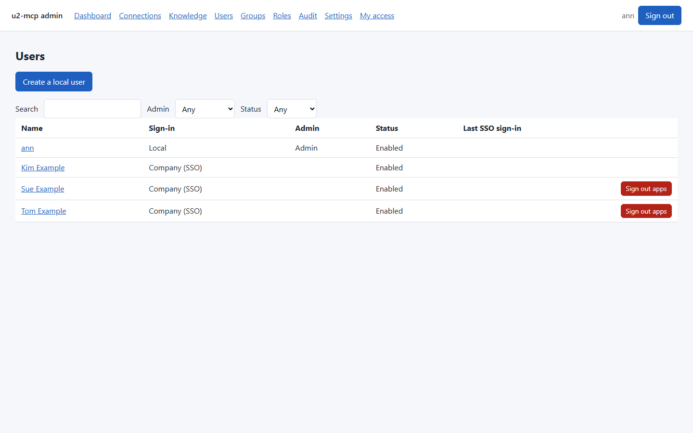
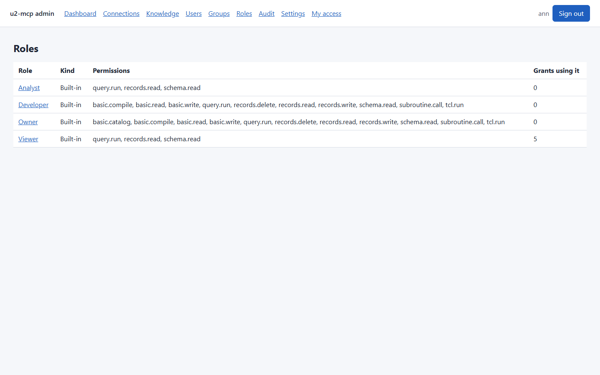
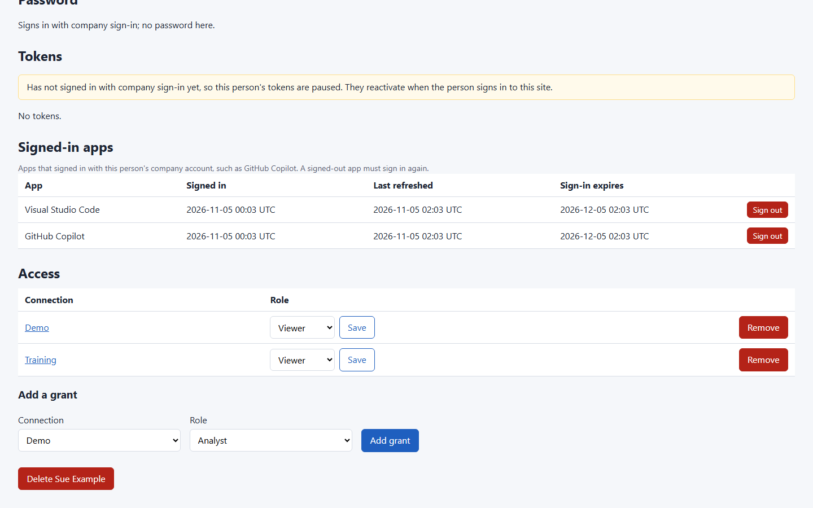
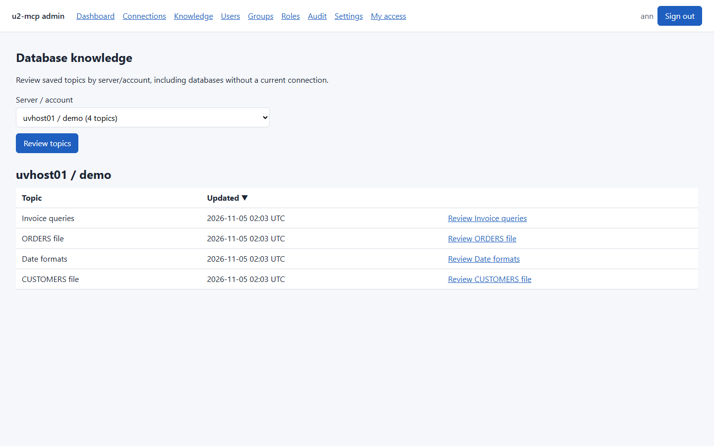
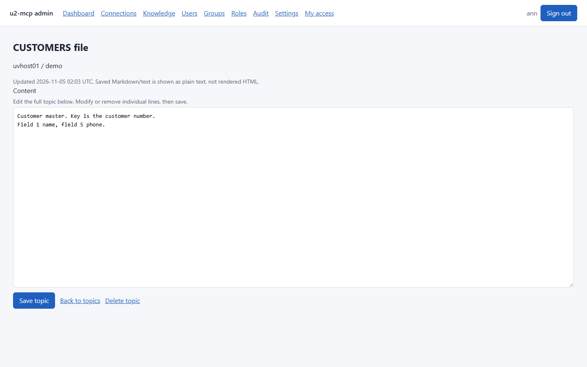
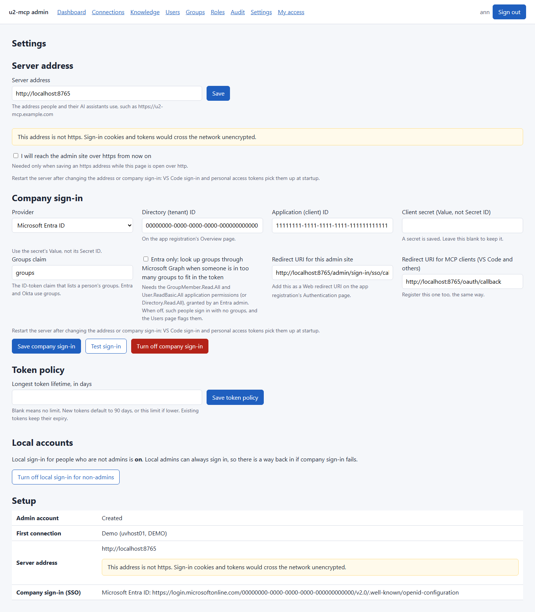
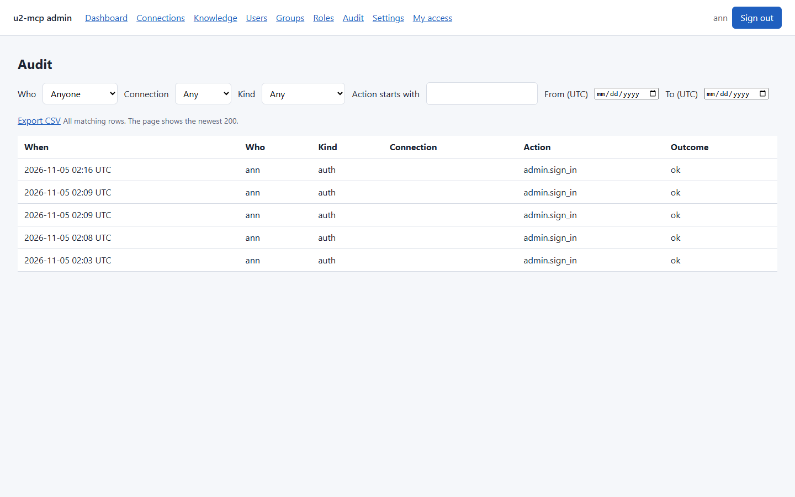
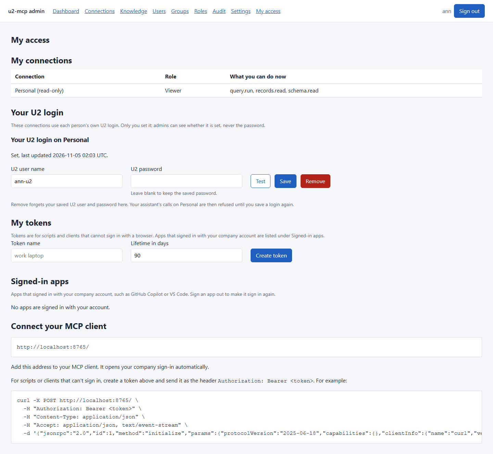

# Running u2-mcp for a team

This guide is for the person who installs and looks after u2-mcp: Docker, the
setup wizard, company sign-in (SSO), a reverse proxy, backups and recovery. For
every environment variable, see [Configuration](configuration.md).

In team mode one server serves several U2 connections to many people. Each
person signs in, and an admin decides per connection who may do what. Servers,
accounts and U2 logins are added on the admin site, not in environment
variables.

## 1. Install with Docker

You need Docker with the compose plugin, and a host that can reach your U2
servers (UniRPC, port 31438 by default).

```bash
git clone https://github.com/cmc0619/u2-mcp-hub.git
cd u2-mcp-hub
python -c "import secrets; print('U2_SECRET_KEY=' + secrets.token_urlsafe(48))" > .env
docker compose up -d
```

`U2_SECRET_KEY` turns team mode on and encrypts the U2 passwords and the SSO
client secret stored in the settings database. **Keep a copy in your password
vault.** Without it, a restored database cannot decrypt its secrets. Once a
database exists, the server refuses to start without its key.

`/data` (`U2_DATA_DIR`, the `u2-data` volume) is the one path that holds
anything persistent, so it can be the only volume you expose. It holds:

- `u2-mcp.db`, the settings database, with its `-wal` and `-shm` files (SQLite
  WAL mode). Connections, people, grants, tokens, company sign-in, knowledge
  notes, the audit log and MCP OAuth sign-ins all live here.
- `logs/uopy.log`, the uopy driver's rotating log. The container's working
  directory is `/data`, and uopy also reads an optional `/data/uopy.ini`.

The image runs as an unprivileged user, and answers `GET /health` for the
container health check.

Run one replica. Sign-in rate limits and new-token display are held in memory.

## 2. First start: the setup wizard

1. Get the one-time setup code:
   `docker compose exec u2-mcp u2-mcp admin show-setup-code`.
   It is also in the log: `docker compose logs u2-mcp`.
2. Open `http://<host>:8000/admin/` (or your proxy's https address).
3. Work through the steps. Each one saves when you submit it, so Refresh, Back
   and a closed browser all resume where you were.
   - **Admin account**: the setup code, then a local admin. This account is your
     way back in if company sign-in ever fails, so keep it.
   - **First connection**: host, account, service and how people log in to U2
     (see "U2 logins" below). **Test connection** really connects and runs
     `COUNT VOC`, and shows the driver's error text if it fails.
   - **Server address**: the URL people use, such as
     `https://u2-mcp.example.com`. Use https.
   - **Company sign-in** (optional): see section 3. **Skip this step** if you
     want to add it later under **Settings**.
   - **Done**: a checklist, and a first MCP client configuration.
4. Give people access. Open the connection and add grants under **Access**:
   - a role for a person;
   - a role for an SSO group (once company sign-in is set up);
   - a role for everyone (shown with a warning).

   Admins need a grant too: being an admin gives no data access.

After setup, admins land on **Connections**, and every admin page is a link in
the top bar:



### U2 logins

Each connection has one of two login modes:

- **One shared U2 login for everyone**: the admin types it on the connection
  form. Everyone with a grant uses it.
- **Each person's own U2 login, set by them on My access**: the database sees who
  made each call. Each person opens **My access**, finds **Your U2 login** for
  that connection, and enters their U2 user and password. **Save** stores it,
  **Test** checks it against the server without saving, and **Remove** deletes
  it. The login applies whichever grant gives them the connection: their own, a
  group's or everyone's. Until it is set, their calls on that connection are
  refused with a pointer to My access.

  Admins never see or type a personal password. On the connection's **Access**
  section and on the person's page, an admin sees only whether a login is set,
  its U2 user name and when it changed, and can **Clear** it. Changing the
  connection's server forgets every personal login on it.

### People



On **Users**, an admin can create local users, make someone an admin, disable or
enable them, reset a local user's password (type one, or **Generate** one that is
shown once), edit names and email, and delete a person.

Deleting a person removes their tokens, their grants, their personal U2 logins
and their sign-in sessions, and signs their AI assistants out (their MCP OAuth
tokens are revoked); the audit history stays. For someone who signs in
with their company account: to keep them out, **Disable** them instead. Deleting
doesn't stop them signing in again with company sign-in, and they then get any
access their groups (or an everyone grant) give.

### Roles



| Role | Permissions |
|------|-------------|
| Viewer | `schema.read`, `records.read`, `query.run` |
| Developer | Viewer + `records.write`, `records.delete`, `tcl.run`, `subroutine.call`, `basic.read`, `basic.write`, `basic.compile` |
| Owner | Developer + `basic.catalog` |

Database knowledge tools are baseline access for anyone authorized to use the
selected connection, including read-only connections. Notes are shared by normalized
server/account, not by connection name or login, so only admins can take them away:
anyone can save a new topic or add to one, but `delete_knowledge` and replacing an
existing topic need an admin (who also needs a grant on the connection). No role
can hand that out. See [Knowledge](tools.md#knowledge-persistence)
for how server and account names are compared.

The roles page lists the tools behind each permission. The BASIC permissions cover only files matching `U2_BASIC_FILES`. `basic.write`, `basic.compile` and `basic.catalog` are writes, so they are refused on a read-only connection and when `U2_READ_ONLY` is on.

Permissions control tools, not files. Program files are still ordinary files, so a role with `records.read` can read program source with `read_record`, and a role with `records.write` can change it with `write_record`, without the BASIC tools' changed-since-read check. Leaving out `basic.write` doesn't protect source from a role that keeps `records.write`.

### Signing out someone's apps



Apps such as GitHub Copilot or VS Code that signed in with a person's company
account keep working until their sign-in expires. To cut one off now:

- On **Users**, the red **Sign out apps** button next to a person's name signs
  every app out of their account. It appears only for people with an app signed in.
- On a person's page, **Signed-in apps** lists each app with its own red
  **Sign out** button.

A signed-out app must sign in again, so this does not lock the person out: to
do that, **Disable** them. Each sign-out is in the audit log as
`oauth_app.sign_out`, with the admin as the actor. People can sign out their
own apps on **My access**.

### Reviewing and editing knowledge



Only admins see the **Knowledge** tab; its pages refuse everyone else. Admins can open it and select a **Server / account** pair to
review saved topics. The selector comes from persisted notes, not live sessions
or the connection list, so databases with notes remain available after their
connections are removed. Labels use normalized server/account identities.



Open a topic to edit its full multiline Markdown/text. Modify or remove
individual lines and choose **Save topic**; blank content keeps the topic.
Saved content is displayed as plain text, never rendered as HTML. **Delete topic**
opens a separate confirmation showing the saved content; **Cancel** changes
nothing, and **Confirm delete topic** permanently removes only that topic.

Edits and deletions reject a stale revision if another admin or MCP tool changed
the topic after it was opened. An edit conflict keeps the unsaved draft on screen:
copy it before reloading the saved topic and merging your changes. Admin changes
appear in Audit without copying the topic's contents into the audit log.

Each server/account is remembered when a connection to it is added or edited,
so its notes stay listed after the connection is removed. Only admins can list
or manage these notes here; this does not change MCP connection permissions.

## 3. Company sign-in (SSO)



Company sign-in works for this admin site at once. For VS Code and other MCP
clients' browser sign-in it works after a restart (`docker compose restart
u2-mcp`), and only with an https server address. Register **two redirect URIs**
with your identity provider. The company sign-in form shows both, with your
address filled in:

- `<public URL>/admin/sign-in/sso/callback` (this admin site)
- `<public URL>/oauth/callback` (VS Code and other MCP clients; only needed if
  people sign in from their MCP client rather than with a token)

`<public URL>` is the server address from the wizard or **Settings**, such as
`https://u2-mcp.example.com`.

Once company sign-in is set up, a **Groups** tab appears in the menu. It lists
the groups seen at sign-in, so you can label them and give them grants.

### Microsoft Entra ID

Menu names below are as of 2026; Microsoft renames these occasionally.

#### Required permissions and consent

For normal company sign-in, u2-mcp requests the OpenID Connect scopes
`openid profile email`. Configure these as Microsoft Graph **delegated**
permissions (`openid`, `profile`, `email`) in the app registration. They
identify the signed-in person; the application does not call Graph's `/me`
endpoint and does not require `User.Read` for this flow. The code does not
request Entra's `offline_access` scope.

| Scenario | Entra permissions | Consent |
|---|---|---|
| Sign-in, including group IDs supplied in the ID token | Delegated `openid`, `profile`, `email`; configure the `groups` ID-token claim separately | Subject to the tenant's user/admin consent policy |
| Optional Graph fallback when groups exceed the token limit | Application `User.ReadBasic.All` **and** `GroupMember.Read.All` | Entra administrator consent required |

The recommended setup uses **Groups assigned to the application** in the
ID-token claim and leaves the Graph fallback disabled. This avoids adding
tenant-wide Graph application permissions when token group claims suffice.
Group claims are token configuration, not an additional Graph API permission.

The optional fallback uses a client-credentials token for
`https://graph.microsoft.com/.default`, then calls
`POST /v1.0/users/{oid}/getMemberGroups`. Its application permissions allow
directory reads beyond just users assigned to this app. `GroupMember.Read.All`
alone is insufficient for this user endpoint. Do not add `Directory.Read.All`
unless deliberately choosing that broader alternative. Microsoft documents
the permission combinations in
[getMemberGroups permissions](https://learn.microsoft.com/en-us/graph/api/directoryobject-getmembergroups?view=graph-rest-1.0#permissions).

No Azure subscription role (Reader, Contributor, or Owner), Azure resource API
permission, directory write permission, or mail/file access is needed for
u2-mcp sign-in. Azure deployment identities are separate. Entra authenticates
the person; u2-mcp's own connection grants and roles determine their U2 access.

Register both as **Web** redirect URIs, using your server's address:

- `https://u2-mcp.example.com/admin/sign-in/sso/callback`
- `https://u2-mcp.example.com/oauth/callback`

Set **Settings -> Server address** to `https://u2-mcp.example.com`.
The callback fields are read-only because they are generated from that address
and fixed application routes. A saved server address takes precedence over
`U2_PUBLIC_URL`. Restart u2-mcp after changing the address or company sign-in.
Use the authorization-code flow; do not enable implicit grants just to use
these callbacks. The Entra client ID and secret belong in u2-mcp's company
sign-in settings, not in Copilot's optional OAuth client ID field: Copilot
registers with u2-mcp's OAuth bridge, while u2-mcp authenticates against Entra.

#### App registration setup

1. **Microsoft Entra admin center** → **App registrations** → **New
   registration**.
   - Choose *Accounts in this organizational directory only*.
   - Under **Redirect URI**, choose the platform **Web** and enter
     `<public URL>/admin/sign-in/sso/callback`.
   - After registering, open **Authentication** and add
     `<public URL>/oauth/callback` as a second Web redirect URI if people will
     sign in from their MCP client.
   - On the **Overview** page, note the **Directory (tenant) ID** and the
     **Application (client) ID**.
2. **Certificates & secrets** → **New client secret**. Copy the **Value** at
   once (it is shown only once), not the Secret ID.
3. **Token configuration** → **Add groups claim**. Choose **Groups assigned to
   the application**, and for the ID token choose **Group ID**. Limiting the
   claim to assigned groups avoids "group overage": a person in more than about
   200 groups would otherwise get no groups in the token at all. Then, under
   **Enterprise applications** → your app → **Users and groups**, assign the
   groups that should use u2-mcp.
4. Optional, for group overage: if you cannot limit the groups as in step 3,
   open **API permissions** → **Add a permission** → **Microsoft Graph** →
   **Application permissions**, and add the GroupMember.Read.All and
   User.ReadBasic.All application permissions (or Directory.Read.All), granted
   by an Entra admin. Check Microsoft's getMemberGroups permissions page, since
   these change. In u2-mcp, tick *Entra only: look up groups through Microsoft Graph
   when someone is in too many groups to fit in the token*. Without either, an
   overage person signs in with no groups: group grants do not apply to them,
   and the Users page flags them.
5. In u2-mcp, go to **Settings → Company sign-in** (or the wizard step):
   - **Provider**: Microsoft Entra ID.
   - **Directory (tenant) ID**: from the Overview page (a GUID, or a domain such
     as contoso.com). Your own tenant is required: `common`, `organizations`
     and `consumers` are refused, because their issuer cannot be checked.
   - **Application (client) ID**: from the Overview page.
   - **Client secret (Value, not Secret ID)**: from step 2.
   - **Groups claim**: `groups`.
   - **Save company sign-in**.
6. Click **Test sign-in** (it appears once the settings are saved). A new window
   signs you in for real and shows your subject, email and groups. The test
   saves nothing.

Groups appear in u2-mcp under the IDs Entra sends. Give them readable labels on
the **Groups** page.

### Okta

1. **Applications** → **Create App Integration** → *OIDC* → *Web Application*.
   Add the redirect URIs as **Sign-in redirect URIs**.
2. **Sign On** → **OpenID Connect ID Token** → **Groups claim**. Set the type to
   *Filter*, name `groups`, *Matches regex* `.*` (or a narrower filter).
3. In u2-mcp: **Provider**: *Other OpenID Connect provider (Okta, Google, Auth0,
   Duo, Keycloak)*. **Discovery URL**:
   `https://<your-okta-domain>/.well-known/openid-configuration` (or
   `/oauth2/default/.well-known/openid-configuration` for a custom authorization
   server). Then the client ID and secret, and **Groups claim**: `groups`.
   **Save company sign-in**, then **Test sign-in**.

### Google Workspace

1. Google Cloud console → **APIs & Services** → **Credentials** → **Create
   credentials** → **OAuth client ID** → *Web application*. Add the redirect
   URIs.
2. In u2-mcp: **Provider**: *Other OpenID Connect provider*. **Discovery URL**:
   `https://accounts.google.com/.well-known/openid-configuration`, plus the
   client ID and secret.
3. Google ID tokens carry no groups, so use grants to people (or to everyone)
   rather than to groups.

### Other providers (Auth0, Duo, Keycloak)

Any OpenID Connect provider with a discovery document works:
- authorization code flow with PKCE;
- ID tokens signed with RS256;
- a groups claim, if you want group grants. Name it in **Groups claim**.

The discovery URL must be https and end in `/.well-known/openid-configuration`.

### Personal access tokens and the 30-day rule

MCP clients without browser sign-in use personal access tokens. People create
them on **My access**. A token belonging to an SSO user works only while that
person signs in to the admin site with their company account at least once every
30 days (`U2_TOKEN_FRESHNESS_DAYS`). After that the token is **Paused** and calls
are refused until they sign in again; My access says when their tokens would
pause. That way someone removed from the company, or from a group, loses access
through their tokens too. Tokens of local accounts do not pause.

### Sign-in for people who are not admins

**Settings → Sign-in for people who are not admins** can keep everyone who is
not an admin off this admin site, whether they use a local account or company
sign-in. Their open sessions end on their next page. It does not touch MCP:
their personal access tokens and signed-in apps keep working. A refused
company sign-in here is not recorded, so it does not count toward the 30-day
token rule; signing in from an MCP app does. While it is off they
cannot use My access, so they cannot create tokens or set their U2 login. Admins
can always sign in; a local admin is your break-glass path.

## 4. Behind a reverse proxy (https)

Put u2-mcp behind a proxy that terminates TLS. There are two ready examples. Run
them from the repository root, and set the variables on the command line (or
export them): `docker compose -f deploy/...` does not read the root `.env` file.

- **Caddy** (automatic certificates):

  ```bash
  U2_SECRET_KEY=... U2_SITE_ADDRESS=u2-mcp.example.com U2_PUBLIC_URL=https://u2-mcp.example.com \
    docker compose -f deploy/caddy/docker-compose.yml up -d
  ```

- **Caddy with its internal CA**, for a private network without public DNS:
  `deploy/caddy/Caddyfile.internal` issues the certificate from Caddy's own CA.

  ```bash
  U2_SECRET_KEY=... U2_CADDYFILE=Caddyfile.internal U2_SITE_ADDRESS=u2-mcp.corp.example     U2_PUBLIC_URL=https://u2-mcp.corp.example docker compose -f deploy/caddy/docker-compose.yml up -d
  ```

  Clients must trust its **public root certificate**, stored in the Caddy
  container at `/data/caddy/pki/authorities/local/root.crt`. Export only that
  certificate, never the CA private key, and install it in the trust store each
  browser or MCP client uses. Node-based clients may need `NODE_EXTRA_CA_CERTS`
  pointing to a PEM copy. Keep the `caddy-data` volume: it holds the CA, so
  clients keep trusting the server across redeployments.

- **nginx**: `deploy/nginx/`. The example listens on port 80 so it runs as is.
  For production, use the TLS server block at the end of `default.conf`, and
  mount your certificate and key into the nginx container at the paths it names.
  `U2_PUBLIC_URL` is required and must match the block nginx serves: `http://`
  with the port-80 block, `https://` with the TLS block. An `https://` address
  served over plain http makes browsers drop the Secure sign-in cookie, and the
  setup wizard cannot create the first admin.

  ```bash
  U2_SECRET_KEY=... U2_PUBLIC_URL=http://u2-mcp.example.com     docker compose -f deploy/nginx/docker-compose.yml up -d
  ```

In both examples u2-mcp is not published on the host. Only the proxy reaches it,
from a fixed address that `U2_TRUSTED_PROXIES` names. Only then does u2-mcp
believe the proxy's `X-Forwarded-For` and `X-Forwarded-Proto`. The sign-in rate
limit, `U2_ADMIN_ALLOWED_IPS`, the audit log and the https check then see the
real client, not the proxy. Never list an address that clients can reach
directly. With your own proxy:

- set `U2_TRUSTED_PROXIES` to the proxy's address or network;
- make the proxy **replace** `X-Forwarded-For` (nginx:
  `proxy_set_header X-Forwarded-For $remote_addr;`) and set
  `X-Forwarded-Proto`;
- turn off response buffering. MCP's Streamable HTTP streams its responses.

Without a proxy, mount a certificate and key into the container and set
`U2_TLS_CERT` and `U2_TLS_KEY` to their paths there. The root
`docker-compose.yml` does not pass these, so add them to its `environment:` and
a read-only volume for the files.

`U2_ADMIN_ALLOWED_IPS` (addresses or CIDRs) limits who can reach `/admin`. The
MCP endpoint is not affected.

### The audit log

**Audit** lists every tool call and admin change: who, when, which connection,
what and the outcome. The filters apply as you type or choose.



## 5. Backups

Back up two things, and keep them apart:

1. The settings database. Either copy the whole `/data` volume with the server
   stopped, or, while it runs, use SQLite's backup command:
   `sqlite3 /data/u2-mcp.db ".backup /path/backup.db"`. Copying `u2-mcp.db`
   alone while the server runs can lose what is still in the `-wal` file. To
   copy the volume, from the directory with your `docker-compose.yml` (add
   `-f deploy/...` when you use a proxy example):

   ```bash
   docker compose stop u2-mcp
   docker run --rm --volumes-from "$(docker compose ps -aq u2-mcp)" -v "$PWD":/backup      alpine tar czf "/backup/u2-mcp-data-$(date +%F).tgz" -C /data .
   docker compose start u2-mcp
   ```

2. `U2_SECRET_KEY`, in your password vault. Without it, a restored database
   still has its users, grants and audit log, but every stored U2 password and
   the SSO client secret must be entered again. The pages say so: for example
   "The saved secret can't be read with this U2_SECRET_KEY. Enter it again."

To restore, put the whole volume back and start the server with the same
`U2_SECRET_KEY` (replace the file name with your backup's):

```bash
docker compose stop u2-mcp
docker run --rm --volumes-from "$(docker compose ps -aq u2-mcp)" -v "$PWD":/backup   alpine sh -c 'find /data -mindepth 1 -delete && tar xzf /backup/u2-mcp-data-2026-10-31.tgz -C /data'
docker compose start u2-mcp
```

## 6. Recovery commands

Run these on the server (`docker compose exec u2-mcp ...`):

| Command | Use |
|---|---|
| `u2-mcp admin show-setup-code` | Print the setup code while setup is unfinished |
| `u2-mcp admin reset-password <user>` | Give a local user a one-time password (they choose a new one at sign-in) and re-enable them |
| `u2-mcp admin reset-password <user> --admin` | The same, and make them an admin: the way back in when no admin is left |
| `u2-mcp admin set-public-url <url>` | Fix the server address, for example after saving an https address while still on http |
| `u2-mcp admin set-public-url --clear` | Forget the saved address (`U2_PUBLIC_URL`, or host and port, applies) |

Restart after changing the address or company sign-in: VS Code sign-in and
personal access tokens pick them up at startup.

## 7. Connecting your AI assistant

Each person opens **My access**. Under **Connect your MCP client** it shows the
server address, `<public URL>/`, and nothing client-specific:

- **Clients that support sign-in** (GitHub Copilot, VS Code, JetBrains AI
  Assistant and other current MCP clients): add the address. The client opens
  your company sign-in by itself. This needs company sign-in, an https address
  and a restart after company sign-in was set up; until then My access says to
  use a token.
- **Scripts and clients that can't sign in**: create a token on My access and
  send it as the header `Authorization: Bearer <token>`. Never commit a file
  that contains your token. My access shows one example, with your address
  filled in:

```sh
curl -X POST https://u2-mcp.example.com/ \
  -H "Authorization: Bearer <token>" \
  -H "Content-Type: application/json" \
  -H "Accept: application/json, text/event-stream" \
  -d '{"jsonrpc":"2.0","id":1,"method":"initialize","params":{"protocolVersion":"2025-06-18","capabilities":{},"clientInfo":{"name":"curl","version":"1"}}}'
```

It returns the server's `initialize` result (as a server-sent event).

### Claude Desktop

Two ways work for Claude Desktop:

- With company sign-in (https address, after a restart): add u2-mcp as a custom
  connector by its URL, `<public URL>/`, and sign in when asked.
- With a token: run a local bridge such as `mcp-remote` from
  `claude_desktop_config.json`, passing `<public URL>/` and the header
  `Authorization: Bearer <your token>`.

Menus and file formats change between Claude Desktop versions; check its
current documentation for where custom connectors are added.

A person sees only the connections they have a grant on. `list_connections`
shows their role and permissions on each.

### How browser sign-in works (the OAuth bridge)

Once company sign-in is saved and the server address is https (or localhost),
u2-mcp acts as an OAuth authorization server for MCP clients, backed by the same
OIDC client as the admin site's sign-in. It is set up only on the admin site;
restart after changing company sign-in or the address. Without company sign-in,
personal access tokens are the only way in.

1. The client reads `/.well-known/oauth-authorization-server` and registers
   itself through Dynamic Client Registration (`/register`).
2. `/authorize` sends the person to your identity provider, which returns to
   `<public URL>/oauth/callback` (register this redirect URI with the provider).
3. The client exchanges the code at `/token`; `/revoke` revokes tokens. Scopes
   are `u2:read` (required) and `u2:write`. Lifetimes are
   `U2_TOKEN_EXPIRY_SECONDS` and `U2_REFRESH_TOKEN_EXPIRY_SECONDS`.

Public clients (such as GitHub Copilot and VS Code) register with
`token_endpoint_auth_method` `none` and get no client secret; PKCE protects their
code exchange. Clients that register for `client_secret_post` or
`client_secret_basic` get a secret and must send it to `/token` and `/revoke`.

Registered clients, codes, tokens and pending sign-ins are stored as hashes in
the settings database, so a restart signs nobody out. The MCP endpoint is the
server root, `<public URL>/`.

### Signed-in apps



**My access → Signed-in apps** lists each app that signed in with the person's
company account: its registered name, when it signed in, when it last refreshed
its token (about hourly while in use) and when the sign-in expires. **Sign out**
revokes that person's access and refresh tokens for that app only; the app must
sign in again. Each sign-out is audited as `oauth_app.sign_out`. Apps are matched
to people by the identity provider's issuer and subject, as MCP calls are.
Personal access tokens are listed separately under **My tokens**.

## 8. Before each release: manual acceptance against real U2

Rocket U2 cannot run in CI, so before each release check these by hand against a
real UniVerse or UniData server:

1. `python scripts/try-it-here.py`, with the `U2_*` variables for a test
   account, completes.
2. On a fresh `docker compose up`, the wizard's **Test connection** passes
   against the real server, and shows the real error for a wrong password.
3. A grant plus a token from My access lets VS Code list files and read a
   record.
4. On a per-person connection, **Your U2 login** on My access: **Test** passes
   with the right password and fails with a wrong one, and a saved login lets a
   tool call through.
5. Company sign-in against your real identity provider: **Test sign-in** shows
   the expected groups, and a group grant applies.
6. GitHub Copilot, given only the address from My access, opens company sign-in
   and then lists files.
7. BASIC on UniVerse and on UniData:
   - `list_programs("BP")` marks compiled programs (UniVerse from `BP.O`, UniData from `_NAME`).
   - `read_program`, then `write_program` with its hash, saves the program. While another user holds the program's record lock, `write_program` is refused with "is locked by another user; try again later" on both products (UniData's lock error code is unverified).
   - `compile_program` reports `compiled` for a good program, and `failed` with the right line for a broken one. Check the markers listed in `src/u2_mcp/utils/basic_source.py`.
8. `catalog_program` on each product: the output shows a local catalog entry, and cataloging the same program a second time does not wait for a prompt.
9. On a file with more than 50,000 records (or a lower test limit), `list_programs` reports `truncated`, and the next `execute_query` is not limited by a leftover select list.
10. On an NLS-enabled account, check whether a program containing `ü` or `ÿ` in a string reads and saves back unchanged, or is refused with the mark-character message. Record which, in the CHANGELOG entry for the release.
